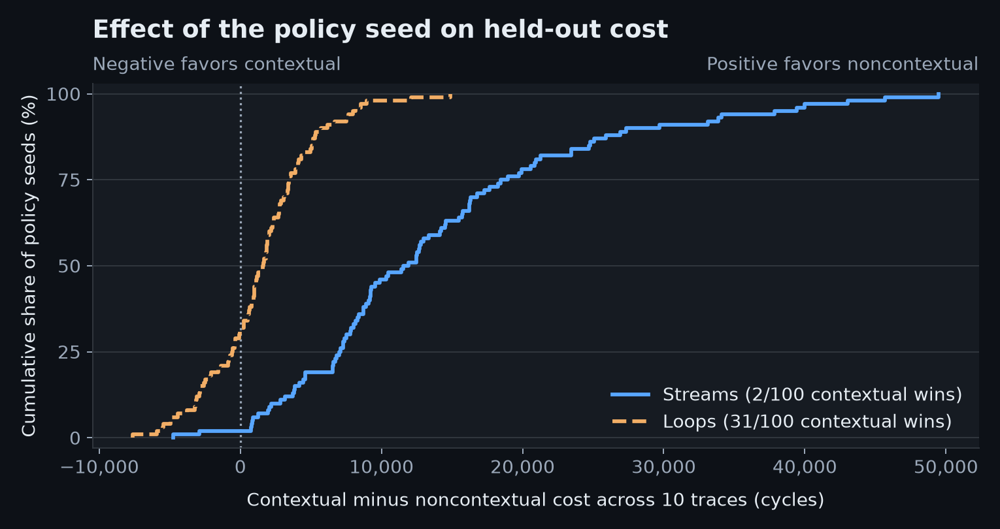
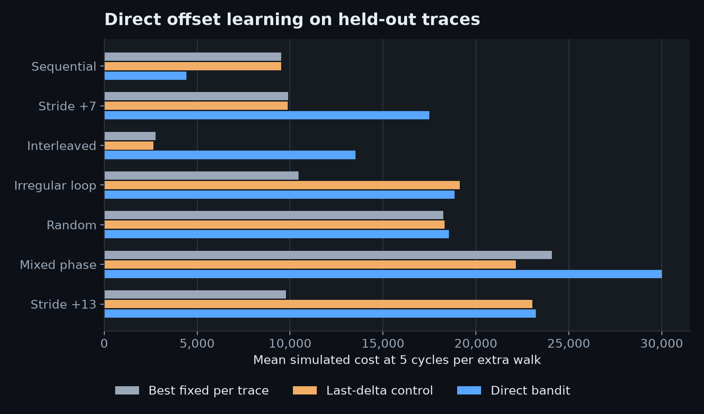
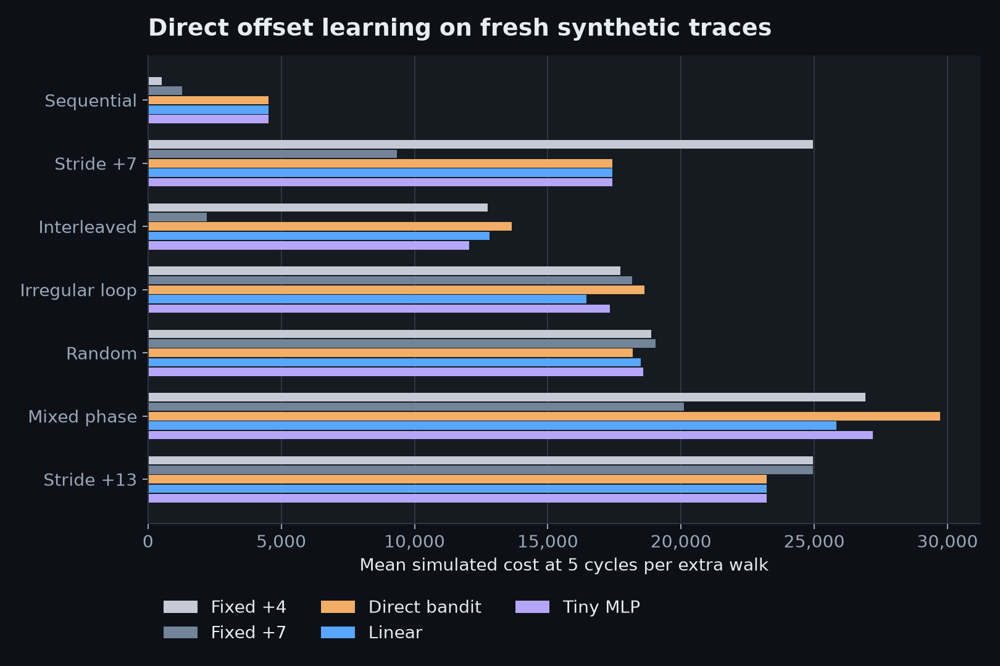

# Can a tiny learning rule help TLB prefetching?

I got the idea during a Computer Systems Engineering class at Instituto Superior Técnico. We were studying virtual memory, page tables and the Translation Lookaside Buffer (TLB). I wondered whether a small learning algorithm could predict which translations a program would need and reduce the time it spent waiting. I built a small simulator to test the idea.

I first let a learner switch among conventional prefetchers. Then I let it predict page offsets directly, first with a table and then with two small neural models. Learning helped in some comparisons. In the final comparison, a deterministic baseline had lower mean cost than every learner in each workload family.

## What a prefetch is worth

A TLB caches translations from virtual pages to physical memory. On a miss, the processor may need to walk the page tables. A prefetcher guesses which virtual page will be needed and asks for its translation early. The simulator handles the translation request. The learner's output is a future virtual page number, and the page tables still determine the mapping.

A correct prefetch can arrive too late to avoid a stall. Looking farther ahead gives a walk more time to finish, but an unused prefetch takes space and can add work. I recorded demand waiting cycles and total translation walks separately, then compared policies with this simulated cost.

```text
adjusted cost = demand waiting cycles + penalty × (total walks - walks without prefetching)
```

The main comparison uses a hypothetical charge of five cycles per extra walk. The comparison CSVs also record costs at zero and twenty cycles per extra walk.

## Experiment 1: Choosing a prefetcher

I started with three conventional policies. Next-page requests the following page. Per-PC stride predicts from repeated page differences at the same instruction. Markov uses past page-to-page transitions. I compared them with no prefetching, a hand-written adaptive heuristic and two reward-based selectors. One selector kept a single set of preferences. The other kept separate preferences by context. Both could choose a candidate or abstain.

On five mixed-phase traces, the noncontextual reward selector had the lowest total adjusted cost at **108,560**, about **9.6% lower** than per-PC stride at **120,075**, the best of the three original fixed predictors. The contextual selector cost **111,990**. The result showed that switching could help when sequential, strided, repeating and random phases occurred within the same trace.


On the original Streams and Loops evaluation, conventional predictors led at policy seed zero. Per-PC stride cost **126,310** on Streams versus **145,835** for the noncontextual selector and **149,700** for the contextual selector. Markov cost **152,830** on Loops versus **157,845** and **161,265** for the two selectors.

Across 100 policy seeds, the contextual selector had a lower family total than the noncontextual selector in **2/100 Streams** comparisons and **31/100 Loops** comparisons. Each seed reuses the same ten traces per family, so this measures sensitivity to exploration randomness.



## Experiment 2: Learning page offsets directly

After Experiment 1, I realized that all the proposed addresses still came from predictors I had written. The learner chose which one to trust. I wanted to answer the more direct version of my question from class. Could a learner look at recent accesses and choose the future page offset itself? Would it save enough waiting to justify the extra computation?

### Experiment 2.1: A tabular bandit

The tabular learner adds its chosen offset to the current virtual page. It can choose any nonzero offset from -8 through +8 or abstain. It generates the target without consulting next-page, stride or Markov.

The context uses the latest page difference for the current instruction and whether it repeats. The learner keeps the last page and difference for up to 16 recently used instructions. It records differences from -8 through +8 exactly and uses separate categories for differences below the range, differences above it and missing history. This gives a table of 40 contexts and 17 actions, including abstention.

The learner starts with zero values, explores among valid actions with probability 0.1 and otherwise selects the highest value. Greedy ties favor abstention. A useful prefetch earns its saved waiting cycles. A wasted walk earns -5 and a rejected request earns zero. Feedback updates the context and action that issued the request, moving its value 20% toward the reward.

On the sequential evaluation traces, the tabular bandit averaged **4,421** adjusted cycles and next-page averaged **9,514**. I then swept all 16 fixed offsets on those same traces. Fixed +4 averaged **449** and fixed +7 averaged **1,091**. On mixed-phase traces, fixed +7 averaged **19,925** versus **30,018** for the bandit. These are retrospective checks. The sequential result showed that the initial comparison missed a strong, simple alternative: a prefetch issued several pages ahead has more time to finish. At the other extreme, the bandit could reach no future demand on the +13 stride trace.



The figure's “Best fixed per trace” bar uses the lowest cost among next-page, per-PC stride and Markov on each trace after evaluation. The fixed-offset sweep was separate.

### Experiment 2.2: Linear and neural reward models

The table stores each context's action values separately. I wanted to see whether a model with shared parameters could use what it learned in one context to help in another. I compared the table with a linear model and a tiny multilayer perceptron (MLP). The two new models receive the same context information in a different form: a one-hot encoding of the 20 difference categories and a repetition bit.

| Model | Value representation | Values or parameters |
| --- | --- | ---: |
| Tabular bandit | 40 contexts × 17 actions | 680 |
| Linear | 21 inputs and 16 outputs | 352 |
| Tiny MLP | 21 inputs, 16 tanh units and 16 outputs | 624 |

All three use the same offsets, the same prefetch feedback and 10% exploration. Each run starts without learned task-specific values and updates online as outcomes arrive. The neural models divide the reward by walk latency and take a squared-error SGD step at rate 0.05. They use the issuing features and the weights available when feedback arrives. The linear parameters start at zero. The MLP starts with small random hidden weights, zero output weights and zero biases. Abstention has a fixed score of zero in both. This setup rewards timely translation requests, including ones that look beyond the immediate next page.

I included fixed +4 and +7 before evaluating workload seeds 401 through 410, with ten policy seeds per learner and trace. The table reports mean adjusted simulated cost at five cycles per extra walk. The last column identifies the lowest mean after evaluating the predefined deterministic policies for each family. Each row can name a different policy. This reference has no online selection rule.

| Workload | Tabular | Linear | Tiny MLP | Best deterministic policy (retrospective) |
| --- | ---: | ---: | ---: | --- |
| Sequential | 4,519.35 | 4,519.35 | 4,519.35 | Fixed +4 (505.50) |
| Stride +7 | 17,423.85 | 17,423.85 | 17,423.85 | Fixed +7 (9,337.00) |
| Interleaved | 13,650.95 | 12,825.10 | 12,053.20 | Fixed +7 (2,202.50) |
| Irregular loop | 18,627.95 | 16,455.30 | 17,338.15 | Markov (10,373.50) |
| Random | 18,179.60 | 18,499.55 | 18,589.75 | Last delta (17,924.00) |
| Mixed phase | 29,732.45 | 25,836.30 | 27,200.80 | Fixed +7 (20,101.50) |
| Stride +13 | 23,218.50 | 23,218.50 | 23,218.50 | Per-PC stride (9,544.00) |



The figure shows the three learners and the two predetermined offsets. The table's retrospective reference also considers no prefetching, next-page, per-PC stride, Markov and the last-delta control.

Both neural models improved on the table on interleaved accesses, irregular loops and mixed phases. Linear beat the table in all 100 paired mixed-phase runs and 96 of 100 irregular-loop runs. The MLP had a lower mean than linear only on interleaved accesses, where it won 26 of 100 pairs and tied 32. On random traces, the neural models abstained less and added more walks than the table.

## What I learned

The direct learners discovered useful offsets and the neural models improved on the table on some workloads. I cannot attribute those gains to weight sharing alone. The models also differ in their parameterization, update rules and learning rates. A simple deterministic policy had a lower mean cost in every family in the final comparison.

The computation matters too. A dense greedy decision takes about 336 multiply-accumulates for linear or 592 for the MLP, plus 16 tanh activations for the MLP. Feedback also requires a fresh forward calculation and a gradient update. In the retrospective cost calculation, linear could absorb about 6.01 extra cycles per decision on mixed phases and 5.66 on irregular loops before losing its mean advantage over the table. Neither neural model had a positive mean budget against the best deterministic reference in any family.

The sequential result changed how I interpreted the early win over next-page. A useful prefetch needs the right address and enough lead time. The fixed +4 control showed how much the choice of lookahead alone could matter under this simulator's timing.

## Reproduce the experiments

Run these commands in Windows Command Prompt from the repository root with Python 3.11 or newer. The simulator, Experiment 1 and Experiment 2.1 use the standard library. Experiment 2.2 needs NumPy. Matplotlib is only needed for the figures.

```bat
python -m pip install numpy matplotlib
```

```bat
python -m experiments.demo
python -m experiments.compare --sensitivity --csv results.csv
python -m experiments.finalize
python -m experiments.direct_compare
python -m experiments.direct_compare --lookahead-check
python -m experiments.neural_compare
```

The result files are the [Experiment 1 comparison](results/data/results.csv), [policy seed sweep](results/data/seed_sweep.csv), [mixed-phase diagnostic](results/data/mixed_phase.csv), [direct-offset comparison](results/data/direct_offset.csv) and [neural comparison](results/data/neural_offset.csv). The lookahead command prints the separate exploratory sweep. The figures use the saved CSVs.

```bat
python -m experiments.plot_results
python -m experiments.direct_compare --plot
python -m experiments.neural_compare --plot
```

The results were reproduced with Python 3.12.10, NumPy 2.5.4 and Matplotlib 3.11.2.

## Limitations

- The simulator replays one blocking demand stream. Comparisons use a 16-entry LRU TLB, a separate FIFO prefetch buffer and fixed 60-cycle walks. Demand and speculative walks have no resource contention. Predictor computation takes zero simulated cycles.
- All traces are synthetic! New workload seeds vary traces within the same families, and policy seeds reuse those traces. In Experiment 2.1, the same evaluation traces served to rank and report the fixed offsets. The retrospective reference in Experiment 2.2 selects the best of the predefined policies after evaluation.
- The direct models have a bounded offset range. Their delayed reward credits individual outcomes, even though one prefetch can take resources from another. The reward therefore approximates the full sequential objective.
- The walk charges and assumed neural decision charges of 0, 1, 5 and 20 cycles are applied after simulation. They do not change when a prefetch arrives. The experiment does not implement online training in hardware or measure CPU speedup, power or energy.

## Background reading

- This study examines page-table locality and adaptive TLB prefetching. [Exploiting Page Table Locality for Agile TLB Prefetching (ISCA 2021)](https://www.cslab.ece.ntua.gr/~vkarakos/papers/isca21_agile_tlb_prefetching.pdf)
- Pythia uses context and feedback to choose data-cache prefetch offsets. [Pythia (MICRO 2021)](https://arxiv.org/abs/2109.12021)
- Hashemi and colleagues used recurrent models to predict future memory-address differences. [Learning Memory Access Patterns (ICML 2018)](https://proceedings.mlr.press/v80/hashemi18a.html)
- Zhou and colleagues studied neural reward estimates with uncertainty-based exploration. [Neural Contextual Bandits with UCB-based Exploration (ICML 2020)](https://proceedings.mlr.press/v119/zhou20a.html)
- Gezekelian evaluated a neural TLB prefetcher adapted from TransFetch. [NTUA thesis (2022)](https://dspace.lib.ntua.gr/xmlui/handle/123456789/56801)
- Trail studies temporal TLB prefetching with page-table-embedded deltas. [Trail (2026 preprint)](https://arxiv.org/abs/2610.08483)
