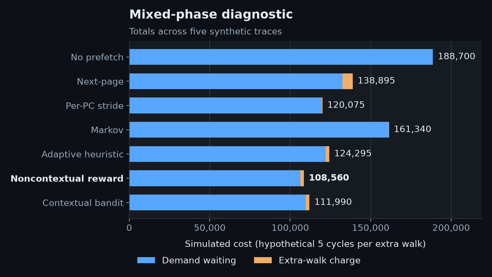

# Can a tiny learning rule help TLB prefetching?

I got the idea for this experiment during a **Computer Systems Engineering** class at **Instituto Superior Técnico**. We were looking at virtual memory, page tables and the Translation Lookaside Buffer (TLB), and I started wondering: if a processor can guess which memory pages a program will need next, could a small learning algorithm help it avoid expensive address translations?

I didn't want to turn a question from class into a CPU-design project. I wanted to write a small simulator, compare a few approaches and find out whether the intuition held up. A negative result would be just as interesting.

**What I found:** Learning from prefetch outcomes helped on some workloads that switch between different access patterns. But giving the learner more context did **not** consistently make it better. In the main held-out tests, the strongest fixed predictors still won.

## The problem, in a minute

Programs use *virtual addresses*, which the processor translates into physical-memory locations. The **TLB** caches recently used translations. When a translation isn't there, a **page walk** may be needed to find it in the page tables.

**TLB prefetching** tries to fetch a translation *before* the program asks for it. If it arrives in time, the program avoids waiting. If it arrives too late, it might save only part of the wait. If it is never used, the work was wasted.

That last point matters: I wasn't just trying to maximize correct guesses. I wanted to test whether the time saved was worth the extra work.

## What I tested

I put together a small, deterministic, trace-driven Python simulator. It replays sequences of virtual-page accesses and models a limited-capacity TLB, a separate prefetch buffer, page-walk latency and pending prefetch requests. All policies see the same traces. The simulator and predictors are in [`tlb_prefetch/`](tlb_prefetch/) and the reproduction scripts are in [`experiments/`](experiments/).

I compared seven policies:

| Policy | Basic idea |
| --- | --- |
| No prefetching | Wait until a translation is needed |
| Next-page | Predict the following virtual page |
| Per-PC stride | Learn a repeating address difference for each instruction |
| Markov | Remember which page tends to follow another |
| Adaptive heuristic | Switch based on recent prefetch outcomes using a hand-written rule |
| Noncontextual reward selector | Learn which of those predictors tends to pay off overall |
| Contextual bandit | Learn separate preferences for eight simple access-pattern situations |

The last two use small tables of action values, not neural networks. They choose among the three existing predictors or choose **not to prefetch**. **They do not learn to generate new page addresses.** That is the exact scope of this experiment.

For both reward selectors, useful predictions earn the number of waiting cycles they save. Unused prefetches receive a small penalty. The contextual model has **32 action values** (eight situations × four actions), compared with **four** for the noncontextual version. Both use online updates, delayed feedback and occasional exploration.

## How I measured the result

I tracked two costs separately:

1. **Demand waiting cycles:** how long the simulated program waits for translations.
2. **Translation walks:** how much lookup work is done, including speculative prefetches.

For one comparison, I combined them using:

```text
adjusted cost = waiting cycles + 5 × (total walks - walks without prefetching)
```

The five-cycle charge is a **hypothetical penalty**, not a measured hardware cost. Lower adjusted cost is better *within this simplified model*. I also checked other penalties rather than relying on one choice.

## The results

### 1. Switching strategies helped on mixed access patterns

I built a separate diagnostic with five synthetic traces. Each trace repeatedly alternates sequential scans, regular strides, a shuffled repeating loop and random accesses. Different predictors have opportunities to be useful in different parts of the same trace.



Across those five traces, the **noncontextual reward selector** had the lowest adjusted cost: **108,560**, compared with **120,075** for the best fixed predictor across the combined results. That is about **9.6% lower adjusted simulated cost**. Both reward-based selectors beat every fixed predictor on each of the five traces.

The surprise was that the *simpler* noncontextual learner also beat the contextual bandit on all five. More information did not translate into better decisions here.

### 2. The result did not carry over to every workload

I also tested two longer synthetic workload families, **Streams** and **Loops**, with ten held-out workload seeds each. On these traces, a particular fixed predictor was often already a very good fit.

| Held-out family | Best fixed policy | Best fixed cost | Noncontextual cost | Contextual cost |
| --- | --- | ---: | ---: | ---: |
| Streams | Per-PC stride | **126,310** | 145,835 | 149,700 |
| Loops | Markov | **152,830** | 157,845 | 161,265 |

These are totals at the same hypothetical five-cycle penalty. The learned selectors did not beat the best fixed policies on these results.

Because the learning algorithms explore randomly, I also repeated the *same* twenty held-out traces with **100 different policy random seeds**. The contextual model beat the noncontextual model on just **2/100** aggregate Streams comparisons and **31/100** aggregate Loops comparisons.


This sweep tests sensitivity to exploration randomness. It is **not** 100 new sets of applications or workloads.

## What I take from it

The outcome is more interesting to me than a simple win or loss:

- Predicting the right page is not enough. A prefetch has to arrive in time and avoid excessive extra work.
- A predictor that works extremely well on one access pattern can be wasteful on another.
- Learning from numerical feedback can help when the useful strategy changes within a trace.
- More model states can also mean less experience per state. That *might* explain part of the contextual learner's weaker results, but I did not isolate the cause.

**The experiment does not show that learning improves a real CPU.** It shows what happened under a small, explicitly defined simulation and why the extra complexity did not reliably pay off.

## Reproduce it

Use **Python 3.11+** from the repository root. The simulator and experiments require only the standard library.

```bat
python -m experiments.demo
python -m experiments.compare --sensitivity --csv results.csv
python -m experiments.finalize
```

The demo compares scripted prefetching with no prefetching on a short trace. The comparison writes [`results.csv`](results/data/results.csv), and the finalization command reproduces the 100-seed sweep in [`seed_sweep.csv`](results/data/seed_sweep.csv) and the mixed-phase diagnostic in [`mixed_phase.csv`](results/data/mixed_phase.csv).

The two plots use the saved CSVs. To regenerate the PNGs in [`results/figures/`](results/figures/), use an environment with Matplotlib and run the following command.

```bat
python -m experiments.plot_results
```

## Important limitations

The simulator has one sequential demand stream, a **16-entry TLB** for comparisons, a separate prefetch buffer and fixed **60-cycle** translation walks. Walks do **not** contend for shared hardware resources, and predictor computation takes zero simulated cycles. Those assumptions favor prefetching. The added walk penalty is hypothetical and is applied after the simulation, not as real contention.

All workloads are synthetic. The mixed-phase diagnostic uses one policy exploration seed, while the 100-seed sweep reuses the same twenty held-out traces. There are no real-hardware speedup or energy measurements, and this is not a comparison against state-of-the-art implementations on an actual processor.

I treated this as a small test of a question from class, not as a new TLB architecture.

## Background reading

- [Exploiting Page Table Locality for Agile TLB Prefetching (ISCA 2021)](https://cgi.di.uoa.gr/~vkarakos/papers/isca21_agile_tlb_prefetching.pdf), on adaptive translation prefetching and the cost of extra walks
- [Pythia (MICRO 2021)](https://arxiv.org/abs/2109.12021), on reward-driven *data-cache* prefetching, a related but different task
- [Trail (2026)](https://arxiv.org/abs/2610.08483), on temporal TLB prefetching at a much more realistic architectural scale
